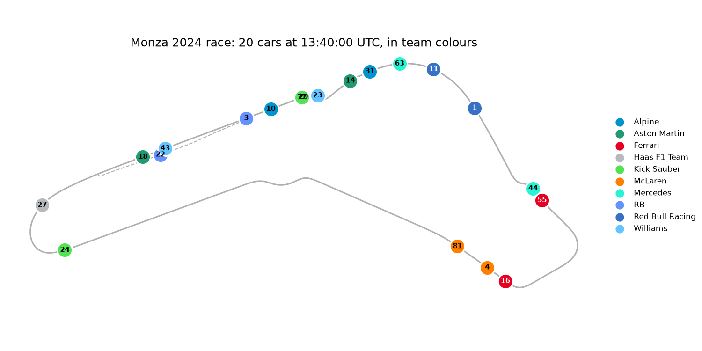

# pitwall

A live F1 race tracker, built step by step: every car on a circuit map in its team colours, with
timing, replay and, later, calibrated predictions. Unofficial and non-commercial; not associated
with Formula 1 or the FIA.



**Status:** Phase 0 of 12 (v0.1.0): the data layer and the track outline. The next phase replays a
past race in the browser. Plan and dates: [docs/schedule.md](docs/schedule.md).

## Run it

Needs [uv](https://docs.astral.sh/uv/) and Python 3.12.

```bash
uv sync              # install
make check           # ruff, mypy strict, pytest with coverage
make figures         # regenerate docs/figures/ (fetches from OpenF1 once, then uses the cache)
```

## Docs

- [Phase 0 write-up](docs/phases/phase0.md): what exists, the numbers, the decisions
- [Design docs](docs/design/README.md): architecture, ingest, track outline, OpenF1 data, security
- [CHANGELOG.md](CHANGELOG.md): releases

## Data

Race data comes from [OpenF1](https://openf1.org), a free API for Formula 1 data. pitwall is
non-commercial and caches what it fetches so it asks for each request only once.
