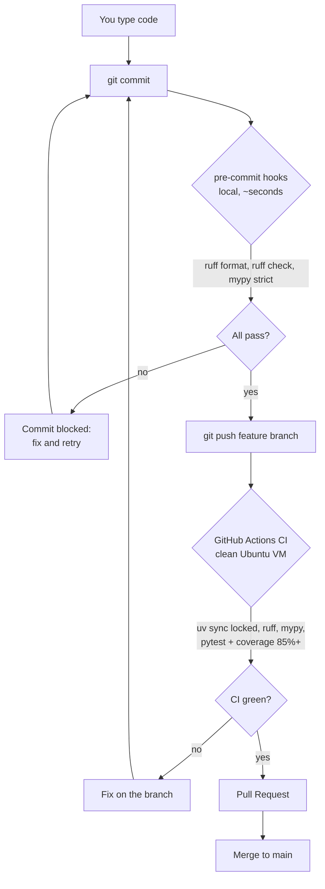

# Development pipeline

**Why both stages:** pre-commit gives fast local feedback but can be skipped
and runs on my machine; CI runs on a clean VM from `uv.lock` and is the actual
gate. `main` only receives CI-green merges.
