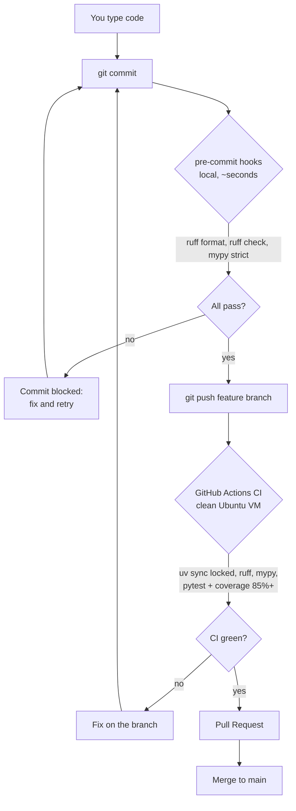
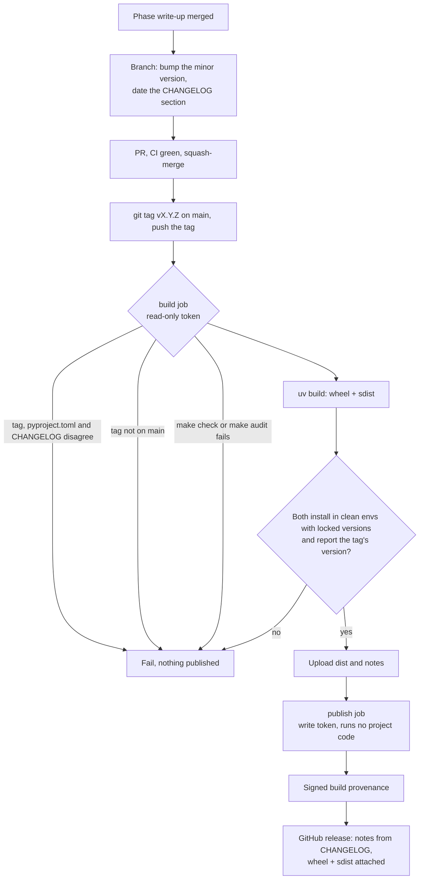

# Development pipeline

**Why both stages:** pre-commit gives fast local feedback but can be skipped
and runs on my machine; CI runs on a clean VM from `uv.lock` and is the actual
gate. `main` only receives CI-green merges.

## Releases

- **Versions** follow SemVer: one minor version per phase (P0 is v0.1.0, P8 is v1.0.0), patches
  between phases. The only place a version is written is `[project] version` in `pyproject.toml`.
  `pitwall.__version__` reads it back from the installed package metadata, and
  `tests/test_package.py` checks the two agree.
- **Bumping:** `uv version --bump minor` (or `patch`) edits `pyproject.toml` and `uv.lock` together.
- **CHANGELOG.md** uses [Keep a Changelog](https://keepachangelog.com/en/1.1.0/). Work goes under
  `## [Unreleased]`; the release PR renames that to `## [X.Y.Z] - date` and opens a new empty
  `Unreleased`. Links inside a release section are absolute, because the same text becomes the
  GitHub release notes.
- **The tag is the trigger.** The `build` job refuses to go on unless `scripts/release_notes.py`
  finds the tag's version in both `pyproject.toml` and `CHANGELOG.md` (checked first, with the
  standard library only, so a mistyped tag fails in seconds), the tag is on `main`, and
  `make check` and `make audit` pass. It then builds, and installs both the wheel and the sdist in
  clean environments pinned to the versions in `uv.lock`; each must report the tag's version.
- **Two jobs, so the token that can write never meets third-party code.** `build` installs
  dependencies and runs the tests with a read-only token that isn't kept in `.git/config`
  (`persist-credentials: false`), and with the uv cache off, so nothing restored from another run
  can end up in a signed file. `publish` gets `contents: write` (create the release) and
  `id-token` and `attestations` (sign provenance), but it only downloads what `build` produced,
  signs it and publishes it. CI stays read-only.
- **Provenance:** `gh attestation verify pitwall-X.Y.Z-py3-none-any.whl --repo Ekanth-Sai/pitwall`
  checks that a downloaded file was built by this workflow from this repo.
- No PyPI upload: releases live on GitHub only (GHCR images start at P6.R).

Measured for v0.1.0: wheel 17.6 KB (15 modules), sdist 14.9 KB.
