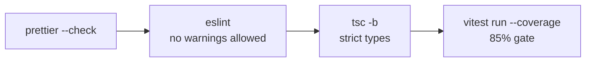
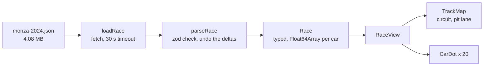
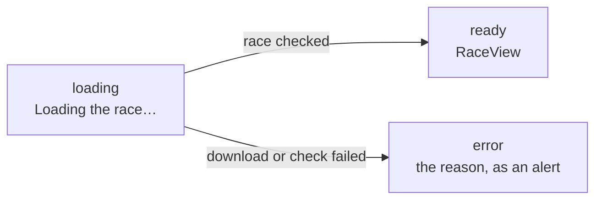

# Frontend

The browser app: React + TypeScript, built with Vite, in `frontend/`. P1.2 set up the tooling and
the gates. P1.3 onwards fill it: the track, the dots, the clock and the controls. It gets the same
standards as the Python code: strict types, a linter that uses those types, a formatter, tests
with an 85% coverage gate, and a CI job.

## Stack

| Tool | Version | Job | Python equivalent |
|---|---|---|---|
| Node.js | 22 (`.nvmrc`), at least 22.22.2 (`engines`) | Runs the tools: the browser runs the built app, not Node | the interpreter |
| pnpm | 12.17.0 (`packageManager` in `package.json`) | Installs packages from `pnpm-lock.yaml` | uv |
| Vite | 8.3 | Dev server with instant reload; bundles the app for production | (none) |
| React | 19.3 | Builds the page from components | (none) |
| TypeScript | 6.0 | Types; `tsc` only checks, Vite strips the types when building | mypy |
| ESLint + typescript-eslint | 10.14 + 8.72 | Lint rules, many of them using the types | ruff check |
| Prettier | 3.9 | Formatting | ruff format |
| Vitest + Testing Library | 5.0 + 16.3 | Tests in a simulated browser (jsdom), with v8 coverage | pytest + coverage |

## Layout

```text
frontend/
├── index.html            the one page; loads src/main.tsx
├── package.json          dependencies and scripts; pins pnpm
├── pnpm-lock.yaml        exact versions of everything installed (commit it, like uv.lock)
├── pnpm-workspace.yaml   pnpm settings: the supply-chain guards below
├── vite.config.ts        Vite + Vitest config, including the coverage gate
├── eslint.config.js      lint rules
├── tsconfig.json         points at the two configs below
├── tsconfig.app.json     types for src/ (the browser code)
├── tsconfig.node.json    types for vite.config.ts (runs in Node)
├── public/               copied as-is into the build: favicon, races/monza-2024.json (P1.1)
└── src/
    ├── main.tsx          entry point: mounts App into index.html's #root
    ├── App.tsx           the top component: downloads the race, then shows it
    ├── RaceView.tsx      the track with every car on it
    ├── index.css         page-wide styles
    ├── race/load.ts      downloads and checks the race file, decodes the deltas
    ├── track/
    │   ├── projection.ts world coordinates (decimetres, y up) to SVG coordinates
    │   ├── TrackMap.tsx  the circuit and the dashed pit lane
    │   └── CarDot.tsx    one car: team colour, number in the ink colour
    └── test/setup.ts     runs before every test file
```

Tests sit next to the code they test, as `*.test.ts` or `*.test.tsx`.

## Scripts

Run from `frontend/` as `pnpm <script>`, or from the repo root through the Makefile.

| Script | Make target | Does |
|---|---|---|
| `install --frozen-lockfile` | `make web-install` | Installs exactly what the lockfile says, or fails |
| `dev` | | Dev server on http://localhost:5173, reloads on save |
| `format` | `make web-fmt` | Prettier rewrites files |
| `check` | `make web-check` | The gate, below |
| `build` | `make web-build` | Type check, then bundle into `dist/` |
| `preview` | | Serves `dist/` locally, to try the production build |

`pnpm check` runs the same steps as CI, stopping at the first failure:



Every gate was checked to fail on purpose with a planted file:
- `xs[0]` returned as a `number` fails `tsc`, because of `noUncheckedIndexedAccess`;
- a `fetch` nobody awaits fails ESLint (`no-floating-promises`);
- an untested function fails the coverage gate.

## Decisions

1. **TypeScript 6.0, not 7.** TypeScript 7 (the compiler rewritten in Go) is out, and the Vite
   template now defaults to it. typescript-eslint 8.72 only supports TypeScript below 6.1, though,
   and type-aware lint rules are worth more here than a faster compiler: the project is small, and
   a cold `tsc` run takes about 3 s. Dependabot ignores TypeScript's minor and major releases
   (its first grouped PR, #151, bumped to 7 and failed CI), so the move is made by hand. Patch
   releases still come through.
   - **When to move:** every phase review runs `pnpm view typescript-eslint peerDependencies`. Once
     the `typescript` range includes a newer version, bump it on a branch of its own.
   - **Cost:** the ignore rule also blocks Dependabot *security* updates for those versions. The risk
     is low because TypeScript is a build tool and never ships to the browser. If an advisory ever
     names it, the phase-review check comes early.
   - **Not chosen:** a separate Dependabot group for the TypeScript toolchain. It would open a red PR
     every week until typescript-eslint caught up, and hold back typescript-eslint's own fixes in
     the meantime.
2. **ESLint, not oxlint.** The template now ships oxlint, a fast linter written in Rust. ESLint
   with typescript-eslint's `strictTypeChecked` preset has the rules that catch real bugs, such as a
   promise nobody awaits or a value typed `any` leaking through. Prettier owns formatting, and
   `eslint-config-prettier` turns off the lint rules that would fight it.
3. **Strictness.** `strict` plus three flags it leaves out:
   - `noUncheckedIndexedAccess`: `xs[i]` has the type `T | undefined`, because the index may be out
     of range. This is the TypeScript version of Python's `IndexError`, caught before running.
   - `exactOptionalPropertyTypes`: an optional property may be missing, but can't be set to
     `undefined` on purpose.
   - `noImplicitOverride`: a method that replaces a parent's must say `override`.
4. **Supply chain.** npm packages have been hijacked to publish malicious versions, and most were
   caught within days. So:
   - `minimumReleaseAge: 10080` (7 days): pnpm won't install a version younger than a week.
     The first install already picked vite 8.3.5 and vitest 5.0.5 over newer releases for this
     reason. The rule covers pnpm itself too: pnpm installs the version named in
     `packageManager`, so that pin is 12.17.0, not the 3-day-old 12.18.0.
   - `strictDepBuilds`: no dependency may run an install script unless it's listed. None needs one.
   - `--frozen-lockfile` in CI, and `pnpm audit --prod` for the packages that ship to the browser.
   - Dependabot opens weekly grouped updates for `frontend/`, like it does for Python, with a
     7-day `cooldown`. CI installs from the lockfile, so pnpm's age check never sees what
     Dependabot writes there; the cooldown applies the same rule on Dependabot's side.
5. **Style.** Prettier with no semicolons and single quotes (the Vite template's style), and 100
   columns to match ruff.
6. **Tests import `describe`, `it` and `expect` from `vitest`** instead of using globals, so every
   name in a test file comes from an import a reader can follow.
7. **Coverage leaves out `main.tsx`.** It only mounts `App` into the page. The tests render `App`
   directly.
8. **pnpm is installed with npm into `~/.local`** (`npm install -g pnpm@12.17.0 --prefix
   ~/.local`). Ubuntu's corepack (0.24) is too old for pnpm 12's layout and fails with
   `Cannot find module …/pnpm.cjs`.
9. **Node floor.** `engines` asks for Node 22.22.2 or later (or 24.15+), because jsdom's
   dependencies do. CI gets the newest 22.x from `.nvmrc`. Ubuntu's own package is 22.22.1, one
   patch behind: the tests pass on it, and pnpm only warns.
10. **Pre-commit.** Prettier formats only the staged files, so a file still being written is left
    alone. ESLint and `tsc` check all of `frontend/` whenever anything in it changes, because a
    change to a config file can break every other file. `make check` stays Python-only: the
    frontend gate is `make web-check`, and both run in CI.
11. **ESLint also checks `.js` files** (`js.configs.recommended`, Node globals), so the config file
    itself and any later script get linted too.
12. **`@types/node` stays on Node 22's types.** `engines` allows Node 22 and 24+, so the types
    follow the oldest of them: code that type-checks then runs on every supported Node, and an API
    that only Node 24 has is a type error. Dependabot ignores their major releases. The major moves
    by hand, in the same PR that raises `.nvmrc` and the `engines` floor.

## Drawing the race (P1.3)

The page downloads `races/monza-2024.json` (the file `make export` writes,
[replay.md](replay.md)), checks it, and draws every car at its first sample. P1.4 makes them
move.



`App` is in exactly one of three states and shows only that one:



1. **The race file is checked when it arrives.** It's input from outside the code, like
   `TrackOutline.from_json` on the Python side. zod checks every field: the format version, a
   start time with exactly 3 fraction digits, bounds with min below max, hex colours, unique car
   numbers, integer columns of equal length, and times that start at 0 or later, strictly
   increase and end within `duration_ms`. Anything wrong becomes a `ReplayError` with zod's
   description of the first 5 problems and a count of the rest (a bad export could have a
   million), and the page shows it instead of drawing something broken. A timeout says "timed
   out", even when it hits while the body is still arriving. Past that point the rest of the app
   trusts the types.
2. **One projection for everything.** `Projection` rotates world points counter-clockwise by the
   export's `rotation`, then flips y, because SVG's y axis points down. The viewBox comes from the
   export's bounds plus a 400 dm margin, so dots at the edges fit. Only positions are projected,
   never the dot itself, so the numbers stay upright.
3. **Sizes are in world units.** The SVG scales the whole track to the window, and a dot (radius
   220 dm, about 44 m across) scales with it. Lines are the exception: they use
   `vector-effect: non-scaling-stroke`, so the circuit is the same 6 px wide at any size.
4. **The loader is passed in.** `App` takes an optional `load` function, which defaults to
   downloading Monza; `loadRace` takes `fetch` the same way. Tests swap in their own and need no
   network, like the swappable transports on the Python side.
5. **A late download is ignored.** The effect that downloads the race clears a flag in its
   cleanup. If `load` changes, or the page goes away, before the download finishes, the old result
   is dropped instead of replacing newer state. A test proves it: it fails when the flag is
   removed.
6. **A car with no samples is left out.** The export never writes one and `parseRace` rejects it,
   but the `Car` type allows empty columns, so `RaceView` checks instead of assuming.
7. **Dots overlap.** At the start, 20 cars sit within about 200 m on the grid, so their numbers
   cover each other. Spreading labels apart is P5.7 (label collisions).
8. **Left for later** (from the P1.3 code review):
   - *P1.7:* the cleanup ignores a late download but doesn't cancel it, so it still finishes and
     runs the check. That only costs anything when `load` changes mid-download, which doesn't
     happen yet, and in development, where `StrictMode` runs the effect twice. Cancelling means
     passing an `AbortController`'s signal down to `fetch`, combined with the timeout.
   - *P1.7:* the check itself (below).
   - *P4.8 (scrubber and race choice):* when `load` changes, the old race stays on screen until
     the new one arrives. It should go back to "loading" once there's a way to pick another race.

### Measured (Monza)

| | |
|---|---|
| `JSON.parse` of the race file | about 40 ms |
| zod check and undoing the deltas | 310 to 400 ms (Node 22 on this laptop; Chrome runs the same V8 engine) |
| Bundle | 312.5 kB JS (95.3 kB gzipped); zod adds 92.6 kB (26.5 kB gzipped) |
| `pnpm check` | 49 tests, 100% coverage |

The check is the slow part, because zod looks at each of about a million integers one at a time.
It's a one-off cost at load, not per frame. P1.7 decides whether a faster check (for example one
plain loop per column) is worth it.

## Measured (P1.2, empty app)

| | |
|---|---|
| `pnpm check` | 15.2 s |
| `pnpm build` | 4.5 s |
| Bundle | 219.9 kB JS (68.8 kB gzipped), almost all React itself |
| `node_modules` | 167 MB, 238 packages; none ships to the browser except React |
