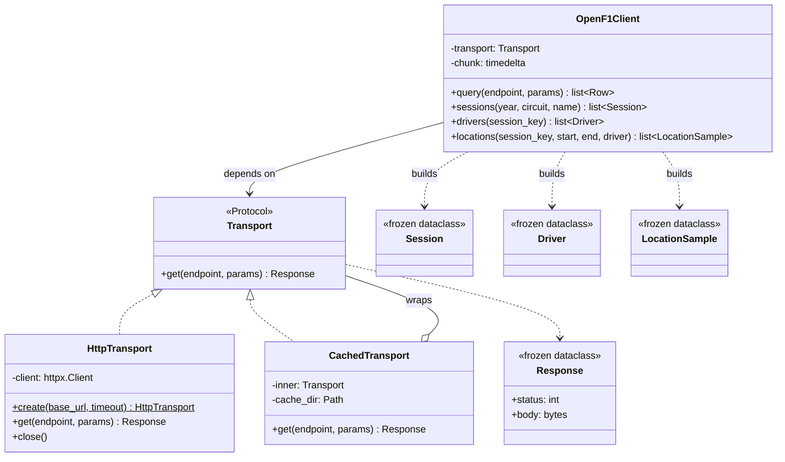
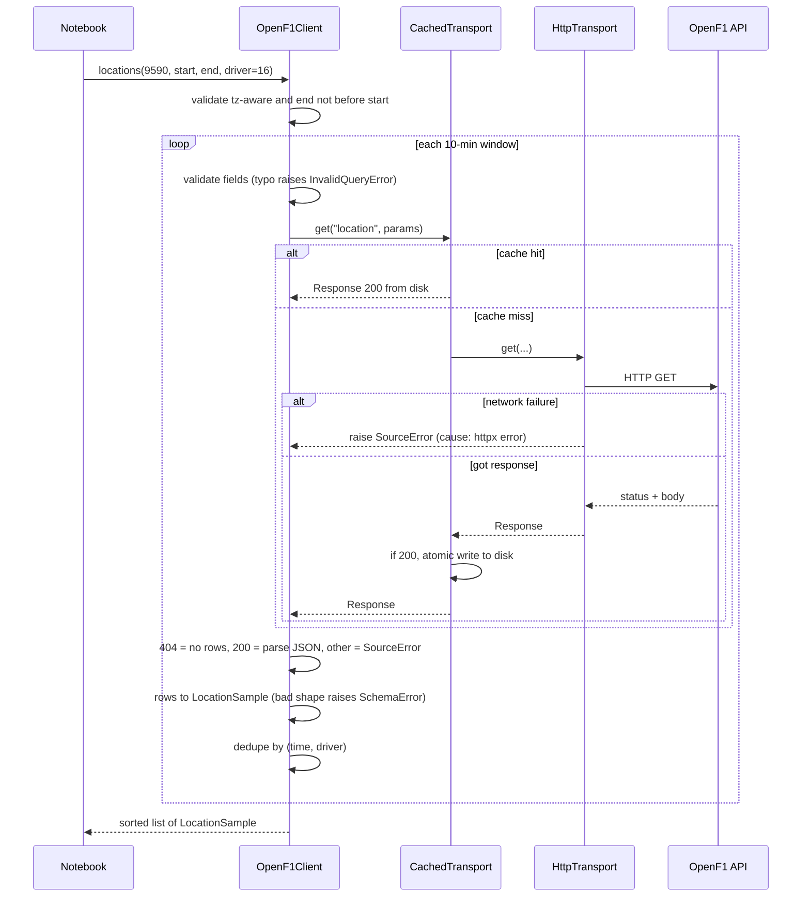

# Ingest: OpenF1 client (P0.4)

## Class diagram

## Sequence: locations()

## Decisions

1. **Transport returns status, doesn't raise on it.** "404 means empty" is an
   OpenF1 rule, so the client interprets status; the transport only raises
   SourceError for network failures.
2. **Caching is a decorator.** CachedTransport wraps any Transport. Only 200
   responses are cached, so errors and empties never get stuck.
3. **Atomic cache writes.** Write to .tmp, then rename: no half-written files
   after a crash.
4. **Validate filters before sending.** OpenF1 answers unknown fields with the
   same 404 as "no results" (the drive_number bug), so typos are rejected locally.
5. **Typed models at the boundary.** Rows become frozen dataclasses on arrival;
   shape problems raise SchemaError there, not deep inside later code.
6. **ValueError for caller bugs, PitwallError for world problems.** Naive
   datetimes and negative chunks are programmer errors; a 401 is not.
7. **No printing in the library.** It uses logging; the caller decides output.
8. **Composition at the edge.** The notebook wires CachedTransport(HttpTransport)
   into OpenF1Client; the client knows nothing about caching or httpx.
