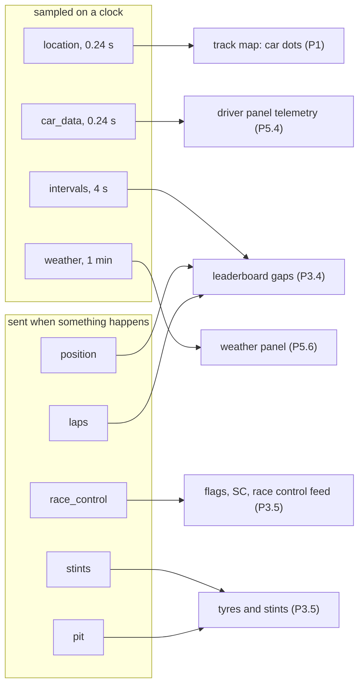
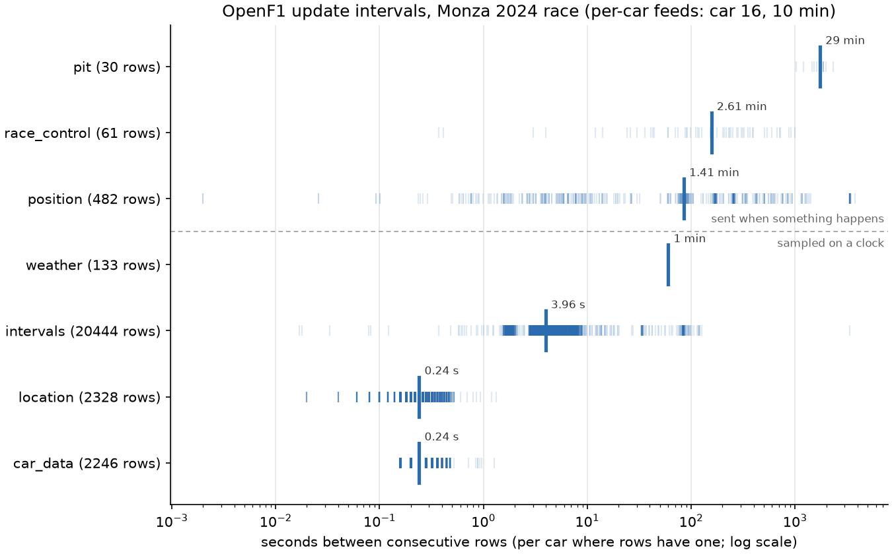
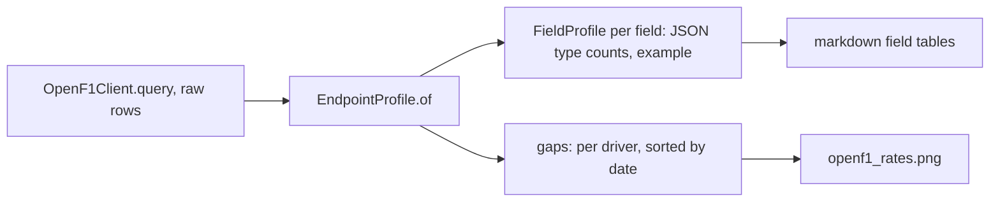

# OpenF1 data: endpoint survey (P0.8)

What each OpenF1 endpoint we'll use actually sends, measured on one race. The tables come from
`scripts/figures/openf1.py` (`make figures`), which also draws the figure. All numbers are from
**Monza 2024, race, session 9590**. The per-car feeds are for car 16, over the 10 minutes from
30 minutes after the session start.

Typed models for these endpoints come with the code that reads them (P3.1). P0.8 only adds
their filter fields to `FIELDS`, so the client can query them, plus `EndpointProfile` to
measure them.

## Where each endpoint goes

## Update rates

The gaps are measured per car, wherever rows carry a `driver_number`.

| Endpoint | Rows (race) | Median gap | Kind | Notes |
|---|---|---|---|---|
| `location` | 2,328 in 10 min, one car | 0.24 s | clock | about 4 Hz; already used by P0.7 |
| `car_data` | 2,246 in 10 min, one car | 0.24 s | clock | OpenF1 says 3.7 Hz; about 17,000 rows per car for the 75 racing minutes |
| `intervals` | 20,444 | 3.96 s | clock | "every 4 seconds"; races only |
| `weather` | 133 | 60 s | clock | one feed for the session, no `driver_number` |
| `position` | 482 | 85 s | event | 20 rows at 12:07:46 (the grid), then a row per change |
| `race_control` | 61 | 2.6 min | event | messages, flags, DRS on/off |
| `pit` | 30 | 29 min | event | one row per stop; the gap is between two stops of one car |
| `stints` | 50 | – | event | no `date`: stints are keyed by lap numbers |

**Two families.** Sampled feeds have a steady median and a narrow spread. Event feeds spread over
four orders of magnitude, because rows come when something happens. That matters for P3.2's
watermark: an event feed can be silent for minutes without anything being wrong, so "no row
for a while" means stale only for the sampled feeds (P7.2).

## Rate limits

OpenF1's free tier allows **3 requests a second and 30 a minute**, with no authentication. Its
docs don't say what happens past that, so I measured it once, with sequential requests:

| | Measured (Nov 2 2026) |
|---|---|
| First refusal | the 5th request, 1.3 s after the first |
| Status | HTTP 429 |
| `Retry-After` | `1` (seconds) |
| Body | `{"detail":"Rate limit exceeded. Max 3 requests/second.","error":"Too Many Requests"}` |
| Headers on a 200 | none about limits: no `X-RateLimit-*` |

What it means here:

- **Today a 429 is a `SourceError`** (`OpenF1Client.query`: any status other than 200 or 404).
  It fails loudly and nothing wrong gets cached, since `CachedTransport` keeps 200s only.
- **Real fetches can hit it.** A single request takes 0.1 to 2 s, so small ones (`pit`,
  `stints`, `weather`) can come back fast enough to make 4 in a second. P0.7 never did,
  because its location chunks take about 1 s each.
- **The survey script waits 0.4 s between requests** (`Paced`, under the cache, so cached runs
  don't wait). That's a stopgap, not the fix.
- **P2.8 builds the real one:** a token bucket at 3/s and 30/min, and a retry that honours
  `Retry-After`. These measurements are its spec. The minute limit wasn't measured on purpose:
  that would take 30+ requests in under a minute, against a free service.

## Per endpoint

Only the surprises are listed. The full field tables (every field, its JSON types with counts,
and an example) are printed by `uv run python scripts/figures/openf1.py`.

### `intervals`
- `gap_to_leader` and `interval` are seconds as a float, **the string `"+1 LAP"`** for a lapped
  car (2,138 rows, 7 cars), or `null`. So the field is `float | str | None`, not a number.
- **`null` is not only the leader.** OpenF1's docs say null means the leader, but cars 23, 20
  and 1 have null gaps too (`gap_to_leader` null on 99 rows, `interval` on 185). Treat null as "unknown", not "leading".
- Rows start at 12:07:46, an hour before the race start (13:03:34): 400 rows with gaps from the
  formation and grid. Anything that uses gaps must start at the race start, not the first row.

### `position`
- One row per driver at 12:07:46 (the starting grid, 20 rows), then a row only when a position
  changes. To know a driver's position at time t, keep the last row before t.

### `stints`
- No `date` field: `lap_start` and `lap_end` place a stint, so joining it to time needs `laps`.
- `tyre_age_at_start` is in laps. Compounds at Monza: HARD 30, MEDIUM 19, SOFT 1.

### `pit`
- `lane_duration` equals `pit_duration` on every row. OpenF1 deprecates `pit_duration` at the
  end of 2026, so use `lane_duration`.
- `stop_duration` (the stationary time) is null on all 30 rows: it only exists from the 2024
  US GP onwards. Monza 2024 is earlier.
- Car 16's stop: lap 15, 24.5 s in the lane. That matches P0.7's in-lap 15.

### `race_control`
- `driver_number`, `flag` and `scope` are null on track-wide messages (35 of 61 rows have no
  driver). `sector` and `qualifying_phase` are null on every race row.
- Categories: `Flag` 29, `Other` 28, `Drs` 2, `SessionStatus` 2. Incidents, track limits and
  pit exit messages are all `Other`, so they can only be told apart by the message text.
- **`date` is UTC, but the message text is local time.** "WAVED BLUE FLAG FOR CAR 10 (GAS)
  TIMED AT 15:47:42" has `date` 13:47:42Z (Monza is UTC+2 in September). Never parse times out
  of `message`.

### `weather`
- One row a minute (59.9 to 60.1 s), °C, %, mbar, m/s and degrees. `rainfall` is an integer
  flag (0 on all 133 rows).

### `car_data`
- `brake` is 0 or 100 only: on or off, not pressure.
- `drs` is a code, not a boolean: 0 (off) 2,102 rows, 8 (eligible) 11, 12 (open) 128, 14 (open)
  5. OpenF1's table: 0 and 1 off; 8 eligible; 10, 12 and 14 open; 2, 3 and 9 unknown.
- Speed 64 to 343 km/h, `rpm` 5,642 to 12,179, `n_gear` 2 to 8, `throttle` 0 to 100 (%).

### Units, together

| Quantity | Unit | Source |
|---|---|---|
| `location` x, y, z | decimetres | measured in P0.7 ([track.md](track.md#units)) |
| durations (`lap_duration`, `lane_duration`, gaps) | seconds, float | OpenF1 docs |
| speed | km/h | OpenF1 docs |
| temperatures | °C | OpenF1 docs |
| `date` | UTC, ISO 8601 with `+00:00` | every endpoint |

## How the survey works

- **`EndpointProfile` works on raw rows**, before any typed model, because its job is to find
  out what the rows look like. It counts each field's JSON types (`null` and `absent` are
  different: a key that's missing is not a key that's null).
- **Gaps are per driver** when rows have a `driver_number`, otherwise across the whole feed.
  Mixing drivers would make `location` look like 80 Hz.
- **An unreadable `date` is a `SchemaError`**: it's the world sending bad data, not a caller bug.
- **The script is glue**, type-checked but not unit-tested, like `scripts/figures/track.py`.
  `EndpointProfile` is the part with logic, and it is tested (100%).

## Decisions

1. **Survey now, type later.** Each endpoint gets its frozen dataclass in P3.1, next to the
   code that uses it. The survey records the facts those models must encode (`"+1 LAP"`,
   nulls, the DRS codes) so P3.1 doesn't rediscover them.
2. **`FIELDS` lists every filterable field** for all eleven endpoints. An unknown filter still
   fails locally, before a request (decision 4 in [ingest.md](ingest.md#decisions)).
3. **Rate limiting waits for P2.8.** The stopgap lives in the script, not the library, so
   there's one real limiter later rather than two.
