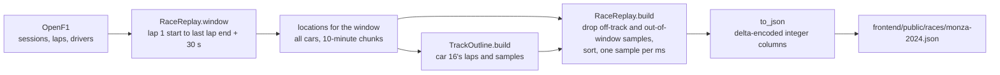

# Race replay export (P1.1)

The browser replay (Phase 1) has no backend. It loads one file per race: every car's position over
time, the drivers and the track outline. `scripts/export_race.py` makes that file from OpenF1, and
`pitwall.replay.export.RaceReplay` holds the logic, so the tests can cover it.



Run it with `make export`: Monza 2024 by default. `--year`, `--circuit`, `--car` (whose laps draw the
outline) and `--out` pick another race. Requests go through `PacedTransport` (0.4 s apart, under the
cache) and `CachedTransport`, so a second run makes no requests.

## Format (version 1)

```json
{
  "format": 1,
  "session": {"name": "Race", "location": "Monza", "year": 2024},
  "start": "2024-09-01T13:03:34.412000+00:00",
  "duration_ms": 4592487,
  "track": {"format": 1, "rotation": -64.63, "bounds": "...", "circuit": "...", "pit_lane": "..."},
  "cars": [
    {
      "number": 16, "acronym": "LEC", "name": "Charles LECLERC", "team": "Ferrari",
      "colour": "E80020", "ink": "white",
      "t": [56, 200, 200, 340],
      "x": [-1151, 0, 0, 1],
      "y": [1892, 0, 2, 6]
    }
  ]
}
```

- **`start`** is the race start (the earliest lap 1 start). **`duration_ms`** runs to 30 s after the
  last lap ends, so the last cars cross the line on screen.
- **`track`** is `TrackOutline.to_json` unchanged ([track.md](track.md)).
- **Per car**, `t` (ms since `start`), `x` and `y` (decimetres, OpenF1's units) are columns of
  **deltas**: the first value, then each value minus the one before. Consecutive samples are 240 ms
  and a few metres apart, so most numbers have 1 to 3 digits. The frontend rebuilds the absolute
  values with a running sum.
- **`colour`** is OpenF1's team colour, grey (`808080`) when OpenF1 sends none. **`ink`** is black or
  white, whichever has more WCAG contrast on it (`pitwall.replay.colours.ink_on`), for the number on
  the dot.
- Samples at `(0, 0)` (OpenF1's "no position") and outside the window are dropped. A car with no
  sample left (example: a car that didn't start) is left out. Two samples in the same millisecond
  keep the first, because the frontend needs times that strictly increase.

## Decisions

1. **The full ~4 Hz, no downsampling.** Downsampling would save size, but it throws away exactly
   what the interpolation steps (P1.4, P1.6) are meant to get right. At 1.27 MB gzipped the file
   loads in well under a second on broadband.
2. **Integers and deltas, not floats.** OpenF1 positions are integers, and times are rounded to
   1 ms, far below the 240 ms spacing. Deltas make the file 4.08 MB instead of 6.54 MB with
   absolute values.
3. **One JSON file, not a binary format.** It's readable and diffable, and gzip on GitHub Pages
   takes it to about 31% of its size. A binary format waits until it's measured to matter.
4. **The file is committed** (`frontend/public/races/`), so deploys never call OpenF1. It's marked
   `linguist-generated` in `.gitattributes`, so GitHub leaves it out of diffs and language stats.
5. **A time column per car, not one shared.** In this race all 20 cars share the same 17,699
   timestamps (OpenF1 samples every car on one clock). One shared column would make the file 0.95 MB
   gzipped instead of 1.27 MB, but it would break on any race where cars' samples differ. That's
   an option for the P1.7 perf review, behind a format bump.

## Measured (Monza 2024 race, Nov 4 2026)

| | |
|---|---|
| Cars | 20 |
| Samples | 353,980 (17,699 per car) |
| Sample spacing | median 240 ms, max 1.32 s; no gap over 5 s |
| Window | 76.5 min |
| File | 4.08 MB, **1.27 MB gzipped** |
| Export time | 34 s with an empty cache, 9.8 s cached |
| Deterministic | two runs give byte-identical files |
