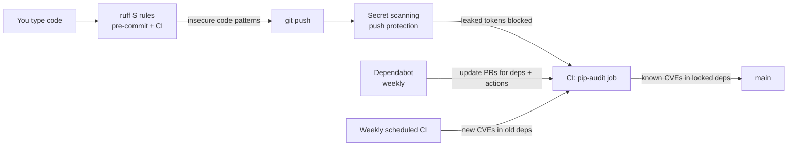

# Security

## Baseline (P0.5)

Four layers, each catching something the others can't.

| Layer | Catches | Runs |
|---|---|---|
| ruff `S` (bandit) | Insecure patterns in our code | pre-commit + CI |
| CodeQL (default setup) | Deeper flaws, e.g. untrusted input reaching a dangerous call across functions; scans Python + Actions | every PR + push to main |
| pip-audit | Known CVEs in locked deps (incl. dev tools) | every PR + weekly |
| Dependabot malware alerts | Known-malicious packages (e.g. typosquats) | continuously |
| Dependabot | Outdated Python deps and GitHub Actions | weekly PRs |
| Secret scanning + push protection | Leaked tokens | every push |
| `permissions: contents: read` | CI token can't write to the repo | always |

`assert` is allowed only in tests (S101): `python -O` strips asserts, so shipped code
validates with exceptions.

The weekly scheduled run matters because a CVE can be published against a dependency
that hasn't changed; without it, nothing would notice until the next PR.

## Threat model

Starts in P4.7, when the API adds attack surface.
