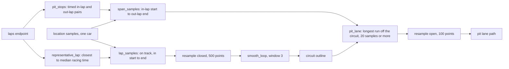
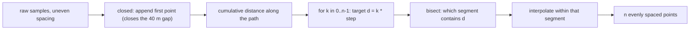
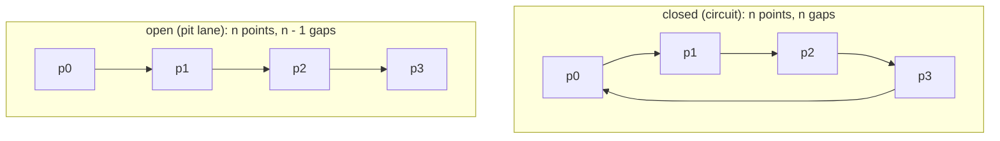
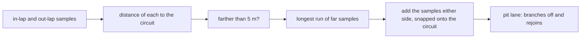
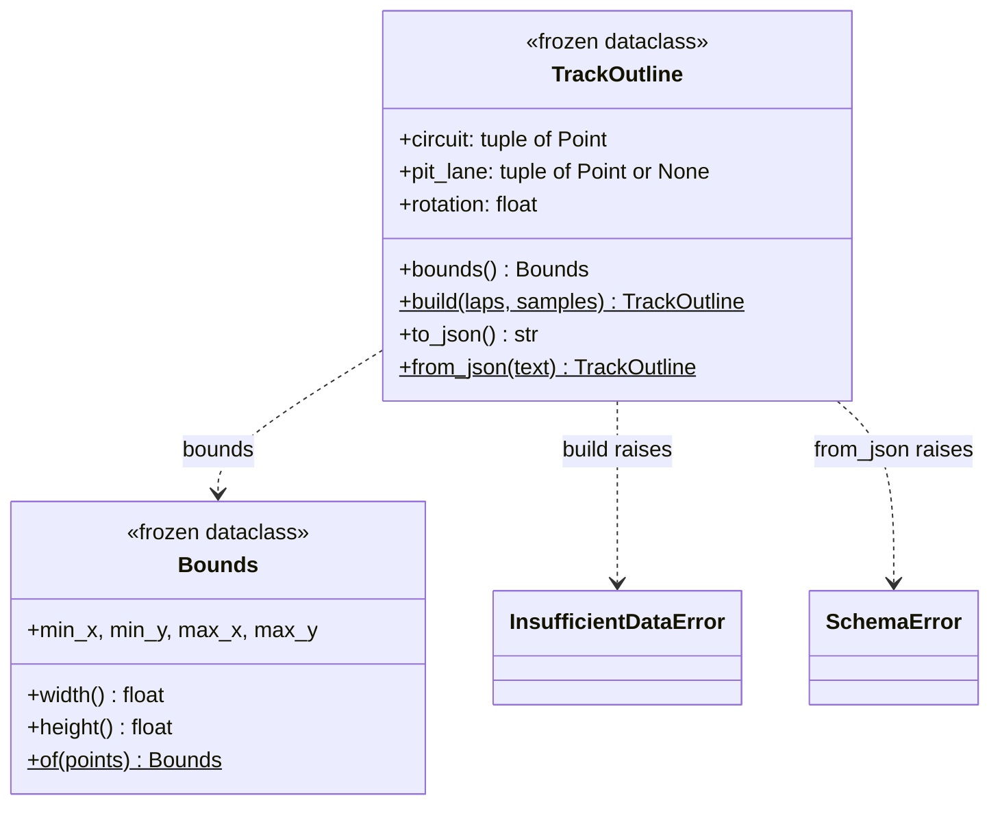
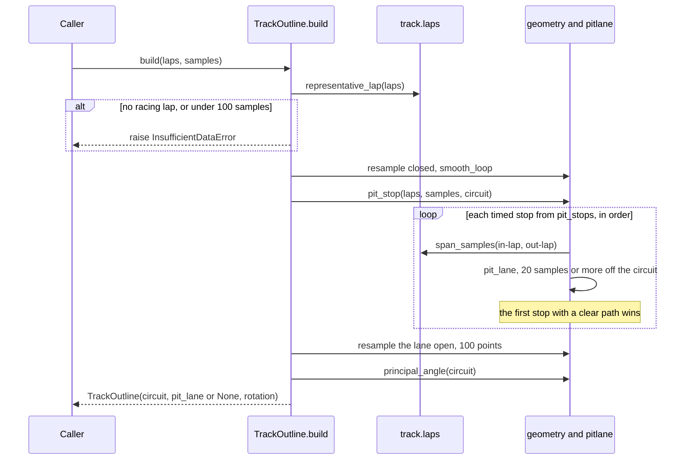
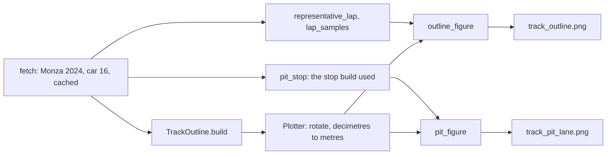
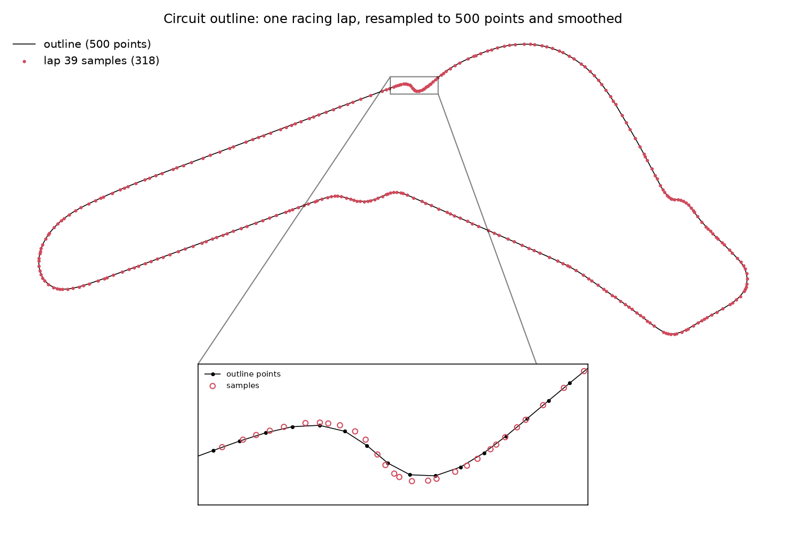
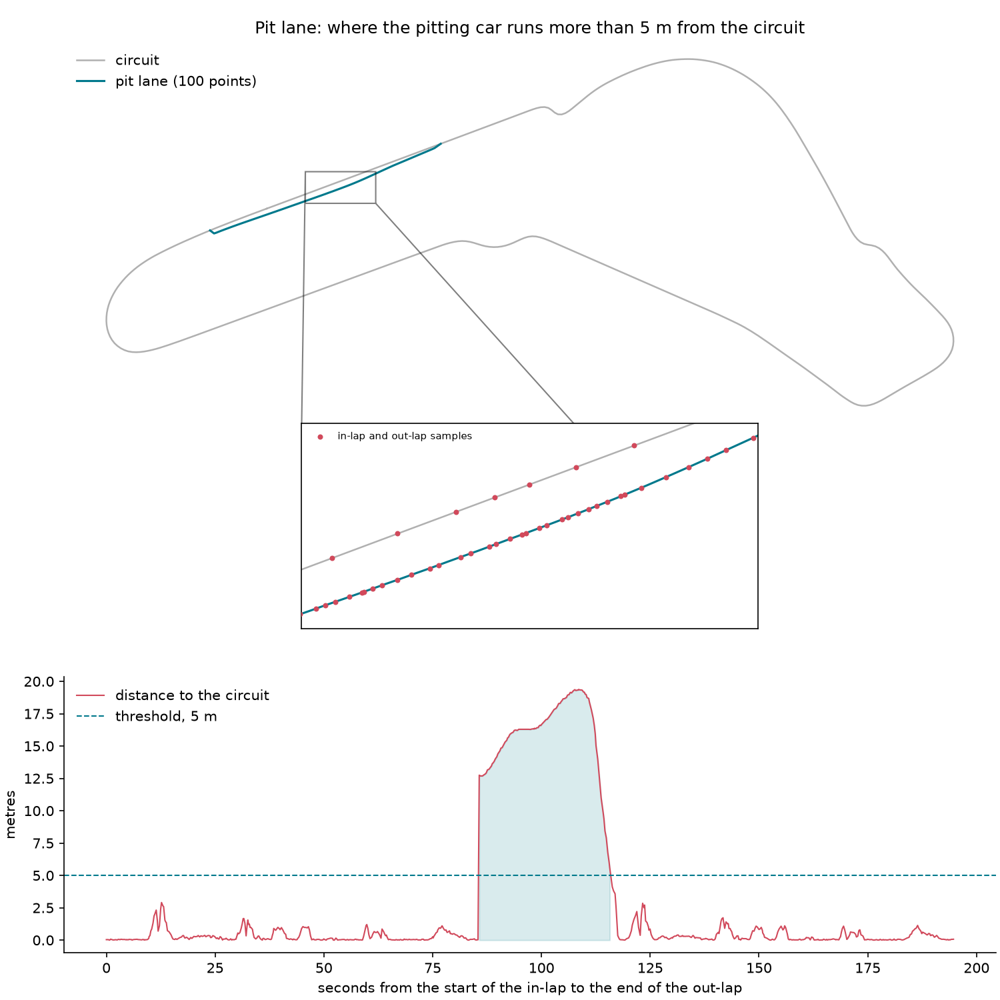

# Track: circuit outline from position data (P0.7)

Built up part by part: lap selection (P0.7b), geometry (P0.7c), pit lane (P0.7d),
`TrackOutline` (P0.7e), figures (P0.7f).

## Pipeline



## Units

OpenF1 `x`, `y`, `z` are integers in **decimetres**. Measured on Monza 2024 (session 9590),
car 16, lap 39: the outline is about 57,490 units long, i.e. **5.749 km** against the official
5.793 km. The 0.8% shortfall is expected: a polyline cuts corners between samples, and
the racing line is shorter than the official centreline.

## Lap selection (P0.7b)

A single lap draws a clean loop; the whole race also traces the pit lane and
safety-car lines. `representative_lap` takes the racing lap closest to the median
racing lap time, where racing laps exclude:

| Excluded | Why |
|---|---|
| Lap 1 | standing start, bunched cars |
| Pit in-lap and out-lap | partly in the pit lane; OpenF1 flags only the out-lap, the in-lap is the one before |
| Untimed laps | null `date_start` or `lap_duration`, can't be placed in time |
| Slower than median x 1.07 | SC/VSC laps |

The median, not the fastest lap: the fastest lap may be an outlier (fresh tyres, a
tow), the median lap is what the car does most of the time.

## Geometry (P0.7c)

### Arc-length resampling



Samples arrive at about 4.2 Hz (median interval 0.240 s), so their spacing follows the
car's speed: about 25 m apart on the straights, much closer in slow corners. Resampling
by distance gives:

- a fixed point count for every circuit (`CIRCUIT_POINTS = 500`, about 11.5 m apart at Monza);
- a uniform SVG path for the frontend;
- a smoothing window of the same physical size everywhere.

**How:** `cumulative[i]` is the distance from the start to `path[i]`. For each target
distance `d = k * step`, `bisect_right` finds the segment containing it in O(log m), and
linear interpolation places the point inside that segment. The index is clamped to the
last segment so the final target, which lands exactly on the end, can't run past it.

**Closed vs open:**



| | closed | open |
|---|---|---|
| Used for | circuit | pit lane (P0.7d) |
| Path | samples plus the first sample again | samples as given |
| Spacing | `total / n` | `total / (n - 1)` |
| Endpoints | first point not repeated | both kept |

The lap's samples stop about 40 m (397 units) short of where they started: two samples at
around 300 km/h. The closed mode joins that gap, so the outline has no break on the
start/finish straight. The gap is never negative: on all 50 of car 16's racing laps the last
sample is short of the first, never past it, so the closing segment can't double back on the
straight (checked in P0.7g, because lap times overlap by about 0.1 s; see the pit lane section).

**Repeated samples:** a stopped or crawling car sends the same position twice, giving a
zero-length segment. Interpolation then uses `t = 0` instead of dividing by zero.

### Loop smoothing

`smooth_loop` is a moving average whose window wraps with `% n`. Point 0 averages with
points n - 1 and 1, so there is no edge kink at the start/finish line, which a plain
moving average would leave.

The window is odd so it's centred on the point. It's tuned against the shift it causes,
measured on the real lap after resampling to 500 points:

| Window | Max shift |
|---|---|
| 3 | 2.3 m |
| 5 | 5.5 m |
| 7 | 8.7 m |
| 9 | 11.4 m |

The track is about 12 to 15 m wide. **Window 3** (`SMOOTH_WINDOW`) removes sample jitter
and keeps every point well inside the track; window 7 and up start rounding off the
chicanes.

### Tests

Example tests pin exact outputs (a square resampled to corners and midpoints, an open line,
repeated points, the wrap at point 0). Property tests (`hypothesis`, integer coordinates of
up to 2 km, like OpenF1's) check what must hold for every path:

| Property | Why it must hold |
|---|---|
| exactly `n` points, starting at `points[0]` | the contract |
| an open path keeps its end | the contract, needed for the pit lane |
| resampling never lengthens a loop | every new point lies on the old path; a chord is never longer than the path it cuts (triangle inequality) |
| translate then resample = resample then translate | nothing depends on where the origin is |
| smoothing keeps the count and the centroid | each point appears in exactly `window` averages, each weighted 1/window |
| window 1 is the identity | the average of one point is the point |

## Pit lane (P0.7d)

The circuit outline comes from a racing lap, so it never goes through the pit lane. The pit
lane comes from a pit stop instead: the in-lap ends in the pit lane and the out-lap starts
there.



**One time window for both laps.** `span_samples(in_lap, out_lap, ...)` takes the samples from
the in-lap's start to the out-lap's end in one pass. Calling `lap_samples` twice and joining the
results could repeat a sample or put two out of order, because OpenF1 lap times can overlap by
about 0.1 s: lap 15's start plus its duration ends after lap 16's start.

**Threshold, from real data** (Monza 2024, car 16, distance to the circuit outline):

| Samples | Distance |
|---|---|
| Every racing-lap sample | at most 2.9 m |
| The cold-tyre out-lap through the first chicane | up to 2.9 m |
| Pit lane beside the main straight | 13 to 19 m |

`PIT_OFFSET = 50` (5 m) sits between them with margin on both sides. Length sensitivity: 4 m
gives 746 m, 5 m gives 707 m, 8 m gives 632 m and 10 m gives 587 m. Only the tapered entry and
exit change; the lane itself is the same.

**Longest run, not every far sample.** A car can briefly run wide (a lock-up, a missed
chicane). A run by sample count favours the pit lane, which is long and includes the stationary
box stop (10 identical samples at Monza).

**At least 20 samples in a row** (`MIN_PIT_RUN`). One stray sample off the outline, from a
GPS spike or a wide moment, would otherwise count as a pit lane, and `TrackOutline.build`
would draw it instead of trying the next stop. Real stops are far longer:

| Race, car | Stop after lap | Samples above 5 m |
|---|---|---|
| Monza 2024, 16 | 15 | 115 |
| Singapore 2024, 16 | 36 | 142 |
| Las Vegas 2023, 1 | 16, 26 | 117, 101 |

20 samples is about 5 s at 4 Hz, a fifth of the shortest one. Racing laps on all three stay
within 3.0 m of their outline, so none comes near 5 m.

**Which stop.** `pit_stops(laps)` pairs each in-lap with its out-lap and drops stops without
timing, which can't be placed in time. `pit_stop(laps, samples, circuit)` returns the first
stop whose samples give a clear pit lane, as a `PitStop` (its samples and the lane as driven).
`TrackOutline.build` and the figures script both use it, so the figure always shows the stop
the outline was drawn from.

**Joining onto the circuit.** The sample just before the run is where the car left the circuit,
and the one just after is where it rejoined. Both are projected onto the outline with
`nearest_on_loop`, so the drawn pit lane touches the circuit exactly. At Monza the entry is
abrupt: one 0.28 s sample interval goes from 0 to 12.7 m off the outline at the end of the
Parabolica. The exit tapers off gradually over about 3 s, before the first chicane.

**Open resampling.** The pit lane has two ends, so `resample(..., closed=False)` keeps both,
with `PIT_POINTS = 100` (about 7 m apart over 707 m). It isn't smoothed: `smooth_loop` wraps
around, which would pull the entry towards the exit. The box stop's repeated samples are
zero-length segments, which resampling already skips.

**`nearest_on_loop`** projects the point onto every segment of the loop (clamped to the
segment's ends) and keeps the closest one. It's O(n) per point. For the 761 in-lap and out-lap
samples against 500 circuit points, that's 0.52 s. The whole `TrackOutline.build` takes 0.43 s
(Monza), 0.48 s (Singapore) and 0.53 s (Las Vegas). This runs once per track and not at replay
time, so it waits for the phase perf review. A spatial grid would make it about O(1) per point
if it's ever needed.

## TrackOutline (P0.7e)

The one object the rest of the system uses: everything above is how it gets built.





**Coordinates stay OpenF1's** (decimetres, y up). The outline is stored unrotated, and the
cars arrive unrotated, so both go through the same transform at draw time. Storing a rotated
outline would force every car position through a different path than the track.

**Rotation** lays the track's long axis horizontal, because screens are landscape. The long
axis is the principal axis of the circuit points: the main eigenvector of their covariance
matrix, whose angle is `atan2(2 sxy, sxx - syy) / 2`. `rotation` is minus that angle, in
degrees counter-clockwise about the origin. Monza: **-64.63 deg**, giving a 2.44 : 1 landscape
outline.

**Bounds** is a property, not a field (like `Lap.end`): it's the bounding box *after*
rotation, i.e. what the SVG viewBox must cover. It's derived, so it can't disagree with the
points. The y-down flip of SVG is the frontend's job (P1.3).

**Rounding to 0.1 dm (1 cm)** at build time. That's far below the data's precision, keeps the
JSON short (Monza: 10.1 kB for 600 points), and makes the JSON round-trip exact: what
`from_json` reads back is equal to what was built.

### JSON format

```json
{"format":1,"rotation":-64.63,"bounds":[-5320.7,-4484.3,18726.7,5356.4],
 "circuit":[[-1333.8,-219.0],...],"pit_lane":[[...],...]}
```

| Key | Meaning |
|---|---|
| `format` | layout version; `from_json` rejects any other value |
| `rotation` | degrees counter-clockwise about the origin |
| `bounds` | `[min_x, min_y, max_x, max_y]` after rotation; written for the frontend, recomputed on read |
| `circuit` | closed loop, first point not repeated |
| `pit_lane` | open path, or `null` |

**`from_json` validates at the boundary.** Every problem becomes a `SchemaError`, from the
same places a bad OpenF1 row would:

| Input | Why it's rejected |
|---|---|
| not JSON, or not an object | |
| `NaN`, `Infinity` | Python's `json.loads` accepts them by default; `parse_constant` rejects them |
| `1e999`, or an integer with 400 digits | the first overflows to `inf` without going through `parse_constant`; the second can't become a float (`OverflowError`) |
| unknown `format`, or `true` or `1.0` | a newer or older layout must not be half-read; `true == 1` and `1.0 == 1` in Python, so the check is on the type too |
| missing key, a point that isn't `[x, y]` | |
| `true` as a coordinate | `bool` is a subclass of `int` in Python, so `isinstance(True, int)` passes |
| circuit under 3 points, pit lane under 2 | `__post_init__` invariants, the same ones `build` must satisfy |

## Race end

`session.end` is the *scheduled* end (15:00 for Monza). `last_lap_end(laps)` is when the
car's last timed lap actually finished (14:18:15). The notebook fetches locations only up to
then: 18,119 samples instead of 18,636, and 8 location requests instead of 12. Three of the
four requests it no longer makes came back empty (404); the fourth held only the cool-down
lap after the flag, which nothing here uses.

## Figures (P0.7f)

`scripts/figures/track.py` (`make figures`) draws both figures from the cached OpenF1 data
into `docs/figures/`. The data, car and constants are the same as everywhere above.



### Circuit outline



The 318 samples of lap 39 (red) lie on the 500-point outline (black) all the way round. The
inset is the first chicane (Variante del Rettifilo), the slowest corner. The script finds it
as the closest pair of consecutive samples, because samples are spaced by time.

- **Samples bunch up there, the outline points don't.** That's arc-length resampling: the car
  is slow, so its samples are close together, while the outline points stay about 11.5 m apart.
- **At the apex the outline sits just inside the samples.** That's the window-3 smoothing,
  which shifts points by at most 2.3 m (see [Loop smoothing](#loop-smoothing)).

### Pit lane



**Top:** the pit lane runs beside the main straight. At the full map's scale it's almost on top
of the track, so the inset zooms in where it is farthest from the track. There, the in-lap's
samples on the straight and the pit lane's samples run in two separate lines.

**Bottom:** the distance from each of the 761 in-lap (15) and out-lap (16) samples to the
circuit, over 195 s. This is the evidence for `PIT_OFFSET`:

| | Monza 2024, car 16 |
|---|---|
| Above 5 m | one run, 85.7 s to 115.7 s: 115 samples, up to 19.4 m |
| Entry | a jump: one sample interval goes from 0 to 12.7 m |
| Exit | a taper back under 5 m over about 3 s |
| Away from the pit lane | at most 2.9 m (the first chicane, on the in-lap and on cold tyres on the out-lap) |

### How the script is built

- **`Figure` objects, not `pyplot`.** No GUI backend and no global state: it runs the same
  headless (CI) as on a desktop, and never opens a window.
- **Drawn in the outline's rotated frame, in metres.** It's the view the frontend will show,
  through the same `rotate` and `rotation`.
- **Insets go in empty space added under the map** (`room_below`), so they never hide track.
- **The pit figure uses the stop the outline used** (`pit_stop`), not just the first in-lap: if
  that one were untimed or unclear, the figure would otherwise show a different stop than the
  lane drawn over it.
- **Zoom targets come from the data:** the closest pair of samples and the farthest pit sample.
  No coordinates are hard-coded, so the script still works for another car or circuit.
- **Reproducible.** The same input gives byte-identical PNGs. The `Software` tag is stripped,
  so a matplotlib upgrade only changes the files if the rendering itself changes, and a PNG
  diff in git means the outline changed.
- **Type-checked, not unit-tested.** It's glue over the tested library code (`scripts` is in
  mypy's `files`). It's checked by looking at its output, like the notebook.

## Decisions

1. **Plain functions, not classes.** Geometry is stateless maths over point lists; the
   stateful object is `TrackOutline` (P0.7e), which uses these functions.
2. **`closed` is keyword-only.** `resample(pts, 500, True)` hides what `True` means.
3. **Tuning constants live in `geometry.py`**, each with its measured reason, not as magic
   numbers at the call site.
4. **`ValueError` for bad arguments** (`n < 2`, even window, zero-length path, a
   non-positive offset, laps of two drivers): these are caller bugs, not data problems from
   the world.
5. **"Not found" is `None`, not an exception.** `representative_lap` and `pit_lane` return
   `None` when the data has no answer (no racing laps, the car never left the circuit). The
   caller decides whether that matters; a track without a pit lane path still draws.
6. **`InsufficientDataError` when the data can't answer.** `TrackOutline.build` has no
   useful `None` to return: without a circuit there is no outline. Well-formed data that
   can't produce one (no racing lap, too few samples) is a world problem, so it's a
   `PitwallError`, not a `ValueError`.
7. **Invariants in `__post_init__`.** A `TrackOutline` with a 2-point circuit can't be built
   by any path: not `build`, not `from_json`, not a direct constructor call.
8. **Versioned JSON.** `format` lets P1+ change the layout without old files being misread.
