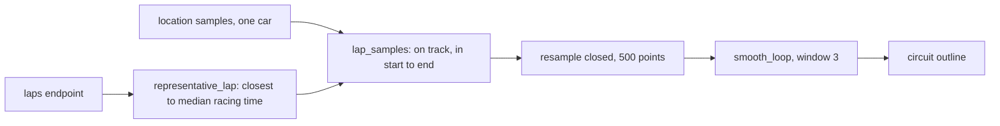
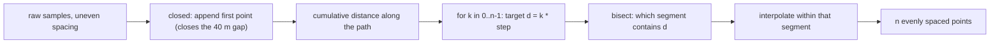
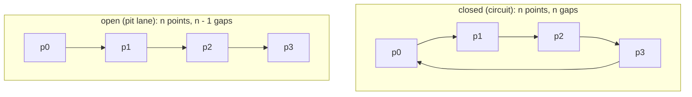

# Track: circuit outline from position data (P0.7)

Built up part by part: lap selection (P0.7b), geometry (P0.7c). Pit lane (P0.7d),
`TrackOutline` (P0.7e) and the figure script (P0.7f) add their sections as they land.

## Pipeline

## Units

OpenF1 `x`, `y`, `z` are integers in **decimetres**. Measured on Monza 2024 (session 9590),
car 16, lap 39: the outline is about 57,490 units long, i.e. **5.749 km** against the official
5.793 km. The 0.8% shortfall is expected: a polyline cuts corners between samples, and
the racing line is shorter than the official centreline.

## Lap selection (P0.7b)

A single lap draws a clean loop; the whole race also traces the pit lane and
safety-car lines. `representative_lap` takes the racing lap closest to the median
racing lap time, where racing laps exclude:

| Excluded | Why |
|---|---|
| Lap 1 | standing start, bunched cars |
| Pit in-lap and out-lap | partly in the pit lane; OpenF1 flags only the out-lap, the in-lap is the one before |
| Untimed laps | null `date_start` or `lap_duration`, can't be placed in time |
| Slower than median x 1.07 | SC/VSC laps |

The median, not the fastest lap: the fastest lap may be an outlier (fresh tyres, a
tow), the median lap is what the car does most of the time.

## Geometry (P0.7c)

### Arc-length resampling

Samples arrive at about 4.2 Hz (median interval 0.240 s), so their spacing follows the
car's speed: about 25 m apart on the straights, much closer in slow corners. Resampling
by distance gives:

- a fixed point count for every circuit (`CIRCUIT_POINTS = 500`, about 11.5 m apart at Monza);
- a uniform SVG path for the frontend;
- a smoothing window of the same physical size everywhere.

**How:** `cumulative[i]` is the distance from the start to `path[i]`. For each target
distance `d = k * step`, `bisect_right` finds the segment containing it in O(log m), and
linear interpolation places the point inside that segment. The index is clamped to the
last segment so the final target, which lands exactly on the end, can't run past it.

**Closed vs open:**

| | closed | open |
|---|---|---|
| Used for | circuit | pit lane (P0.7d) |
| Path | samples plus the first sample again | samples as given |
| Spacing | `total / n` | `total / (n - 1)` |
| Endpoints | first point not repeated | both kept |

The lap's samples stop about 40 m (397 units) short of where they started: two samples at
around 300 km/h. The closed mode joins that gap, so the outline has no break on the
start/finish straight.

**Repeated samples:** a stopped or crawling car sends the same position twice, giving a
zero-length segment. Interpolation then uses `t = 0` instead of dividing by zero.

### Loop smoothing

`smooth_loop` is a moving average whose window wraps with `% n`. Point 0 averages with
points n - 1 and 1, so there is no edge kink at the start/finish line, which a plain
moving average would leave.

The window is odd so it's centred on the point. It's tuned against the shift it causes,
measured on the real lap after resampling to 500 points:

| Window | Max shift |
|---|---|
| 3 | 2.3 m |
| 5 | 5.5 m |
| 7 | 8.7 m |
| 9 | 11.4 m |

The track is about 12 to 15 m wide. **Window 3** (`SMOOTH_WINDOW`) removes sample jitter
and keeps every point well inside the track; window 7 and up start rounding off the
chicanes.

### Tests

Example tests pin exact outputs (a square resampled to corners and midpoints, an open line,
repeated points, the wrap at point 0). Property tests (`hypothesis`, integer coordinates of
up to 2 km, like OpenF1's) check what must hold for every path:

| Property | Why it must hold |
|---|---|
| exactly `n` points, starting at `points[0]` | the contract |
| an open path keeps its end | the contract, needed for the pit lane |
| resampling never lengthens a loop | every new point lies on the old path; a chord is never longer than the path it cuts (triangle inequality) |
| translate then resample = resample then translate | nothing depends on where the origin is |
| smoothing keeps the count and the centroid | each point appears in exactly `window` averages, each weighted 1/window |
| window 1 is the identity | the average of one point is the point |

## Decisions

1. **Plain functions, not classes.** Geometry is stateless maths over point lists; the
   stateful object is `TrackOutline` (P0.7e), which uses these functions.
2. **`closed` is keyword-only.** `resample(pts, 500, True)` hides what `True` means.
3. **Tuning constants live in `geometry.py`**, each with its measured reason, not as magic
   numbers at the call site.
4. **`ValueError` for bad arguments** (`n < 2`, even window, zero-length path): these are
   caller bugs, not data problems from the world.
