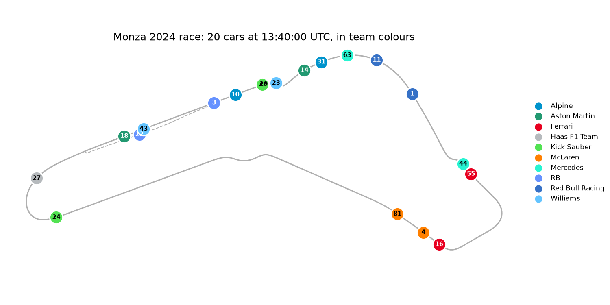
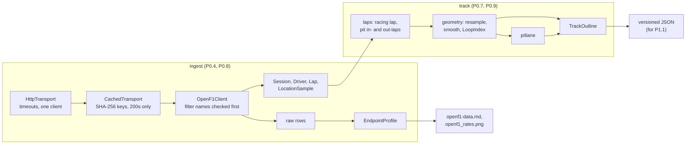
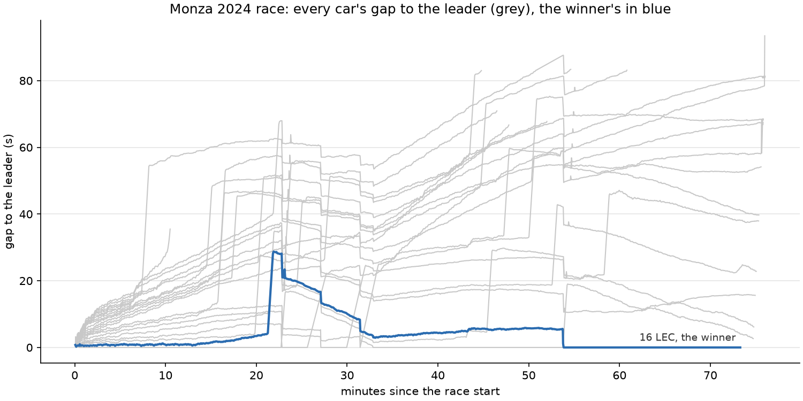

# Phase 0: setup and a first look at the data

**Window:** Oct 26 to Nov 15 2026 · **Release:** v0.1.0 (P0.10) ·
**Steps:** P0.1 to P0.9 · **Board:** milestone `P0 · v0.1.0`

Phase 0's goal was a plot of the circuit with every car on it at one moment, in team colours,
built on code that's tested and typed. This is that plot. Everything below it in this document is what it took to
get there, and what was learned about the data on the way.

Two pairs of cars nearly cover each other (77 over 20, 43 over 22). Those are real positions
a second apart on the straight, and the frontend must handle that: label collisions are P5.7.

## What was built

| Step | What | PR |
|---|---|---|
| P0.1 | uv project, src layout, git | first commit |
| P0.2 | ruff, mypy strict, pytest + coverage gate, pre-commit, CI | #1 |
| P0.3 | Explore notebook: one race from OpenF1, the circuit and all cars | #2 |
| P0.4 | Ingest package: transports, `OpenF1Client`, typed models, errors | #3 |
| P0.5 | Security baseline: ruff `S`, pip-audit, Dependabot, CodeQL, least-privilege CI | #4 |
| P0.6 | Notebook on `OpenF1Client` + `CachedTransport` | #8, #9 |
| P0.7a–g | Track outline: lap selection, resampling, smoothing, pit lane, `TrackOutline` JSON, figures | #143 |
| P0.8 | Endpoint survey: 7 more endpoints, `EndpointProfile`, update rates, the 429 limit | #145 |
| P0.9 | This write-up, the phase perf review (`LoopIndex`), Phase 0 figures | this PR |

The data source changed in the middle of P0.3: the F1 live-timing archive started answering
401 for every year, so Phases 0 to 7 run on OpenF1's free historical API instead. The live
source is decided in P8.1.

## How it fits together

Details are in the design docs: [ingest.md](../design/ingest.md), [track.md](../design/track.md),
[openf1-data.md](../design/openf1-data.md), [security.md](../design/security.md),
[dev-pipeline.md](../design/dev-pipeline.md).

## Figures

| Figure | Shows | Script |
|---|---|---|
| [phase0_field.png](../figures/phase0_field.png) | The whole field at one moment (above) | `scripts/figures/phase0.py` |
| [track_outline.png](../figures/track_outline.png) | The outline against the raw lap it came from | `scripts/figures/track.py` |
| [track_pit_lane.png](../figures/track_pit_lane.png) | Where the pitting car leaves the outline | `scripts/figures/track.py` |
| [openf1_rates.png](../figures/openf1_rates.png) | How often each endpoint updates | `scripts/figures/openf1.py` |
| [phase0_gaps.png](../figures/phase0_gaps.png) | Every car's gap to the leader (below) | `scripts/figures/phase0.py` |

All of them come from `make figures`, from cached data, byte-identical from run to run.

The gap plot is the first view of race state, and it already shows what P3 has to deal with:

- **Pit stops are steps.** Leclerc's line jumps to 29 s at 22 minutes (his only stop, lap 15),
  then falls as the leaders make their own stops. At 54 minutes he takes the lead and his gap
  stays 0 to the flag.
- **Not every row is a number.** 2,237 of the race's rows aren't seconds: 2,138 are the string
  `"+1 LAP"` and 99 are null for cars that aren't leading. They are left out here; P3.1 has to
  type them.
- **Lines start an hour early.** OpenF1 sends gaps from the grid onwards, so the plot starts at
  the race start (13:03:34, lap 1 of car 16, which matches race control's "SESSION STARTED").

## Numbers

| | Value |
|---|---|
| Source | 1,033 lines in `src/` across ingest and track |
| Tests | 173, 1,170 lines; coverage 100% (gate: 85%) |
| Checks | ruff (incl. bandit `S`), mypy strict over src, tests, notebooks and scripts; pre-commit and CI |
| Monza outline | 500 points over 5.749 km (about 11.5 m apart), rotation −64.63° |
| Pit lane | 100 points over 707 m |
| `TrackOutline` JSON | 10,094 bytes |
| Location samples for the outline | 18,119 (car 16, whole race) |
| `TrackOutline.build` | 30 ms (Monza), 42 ms (Singapore), 37 ms (Las Vegas) |
| OpenF1 free tier | 3 requests/s; HTTP 429 on the 5th request in 1.3 s, `Retry-After: 1` |
| Update rates (median) | `location`, `car_data` 0.24 s · `intervals` 3.96 s · `weather` 60 s · `race_control` 58 s |

## Perf review

Phase 0 has no runtime budget yet: nothing runs at replay time. The rule is still to measure,
fix the top bottleneck and record before and after.

**Measured:** `TrackOutline.build` took about 0.5 s per track, and cProfile put **98%** of it
in `nearest_on_loop`. `pit_lane` calls it for each of about 760 in-lap and out-lap samples, and
each call scans all 500 circuit segments: 380,000 point-to-segment projections.

**Fixed:** `LoopIndex` puts the segments in a grid of cells about one segment wide, and a
query only looks at the cells near the point ([track.md](../design/track.md) has the details).

| `TrackOutline.build`, best of 5 | Before | After | Speed-up | Output |
|---|---|---|---|---|
| Monza 2024, car 16 | 498 ms | 30 ms | 17× | identical JSON |
| Singapore 2024, car 16 | 572 ms | 42 ms | 14× | identical JSON |
| Las Vegas 2023, car 1 | 565 ms | 37 ms | 15× | identical JSON |

**How it's known to be right:**

- A hypothesis property test checks that `LoopIndex` finds the same distance as the brute-force
  `nearest_on_loop` for random loops and points, including points far outside the loop.
- A one-off run of 20,000 examples, with duplicate points and up to 60 segments, also passed.
  That run found a real problem on the way: a point far outside the grid walked through
  hundreds of thousands of empty rings. Rings now start where the grid begins and are clipped
  to it.
- The three real outlines are byte-identical before and after.

**Not done, on purpose:** `EndpointProfile` makes one pass per field (99 ms for 20,444 rows).
It only runs in the survey script.

## Security step

Phase 0's attack surface is small: outbound HTTPS to one public API and files in a local cache.

- **Baseline (P0.5):** ruff `S`, CodeQL, pip-audit on every PR and weekly, Dependabot, secret
  scanning with push protection, a read-only CI token. See [security.md](../design/security.md).
- **Input at the boundary:** filter names are checked against `FIELDS` before any request, and
  every row is parsed into a typed model or rejected with a `SchemaError`.
- **Network:** one `httpx` client with timeouts; any status other than 200 or 404 is a
  `SourceError` and is never cached.
- **Cache:** JSON only (no pickle); file names are SHA-256 hashes of the request, so a filter
  value can't pick the path. CodeQL flagged the earlier SHA-1 (alert #3, a false positive for a
  cache key); it was switched to SHA-256 rather than dismissed.
- **Open alerts:** none (code scanning, Dependabot, secret scanning) at the end of the phase.

The threat model starts in P4.7, when the API adds an inbound surface.

## Decisions

1. **OpenF1 instead of the F1 archive** for Phases 0 to 7, after the archive went 401. The
   ingest layer hides the source, so the live adapter in P8 is one more transport.
2. **Validate before the network.** OpenF1 answers an unknown filter with the same 404 as "no
   results", so a typo would look like an empty race. `FIELDS` turns it into a local error.
3. **One median lap, not the whole race.** The outline is the racing lap closest to the median
   lap time, resampled and lightly smoothed. The whole race would also trace the pit lane and
   safety-car lines, and the fastest lap can be an outlier ([track.md](../design/track.md)).
4. **Survey now, type later.** Endpoints get typed models in P3.1, next to their consumers; P0.8
   recorded what those models must handle.
5. **No rate limiter yet.** The figure scripts pace themselves; the real limiter, with a token
   bucket and `Retry-After`, is P2.8, so the library gets one, not two.
6. **Fix the bottleneck even without a budget.** A 15× faster build keeps tests and figure runs
   quick, and the brute-force version stays as the test oracle.

## Open questions

| Question | Where it's answered |
|---|---|
| Live source: OpenF1 paid live or the authenticated F1 feed? | P8.1 |
| Null gaps for cars that aren't leading: "unknown", or something OpenF1 means? | P3.1 |
| The 30-a-minute limit: what happens past it (not measured, on purpose)? | P2.8 |
| Overlapping dots and labels on the map | P5.7 |
| Does one car's lap make a good outline on every circuit (street tracks, layout changes)? | P1.1, checked per race |

## Next

P0.10 adds the release tooling (single-source version, CHANGELOG, release workflow) and tags
**v0.1.0**. Phase 1 then exports one race to JSON and replays it in the browser.
