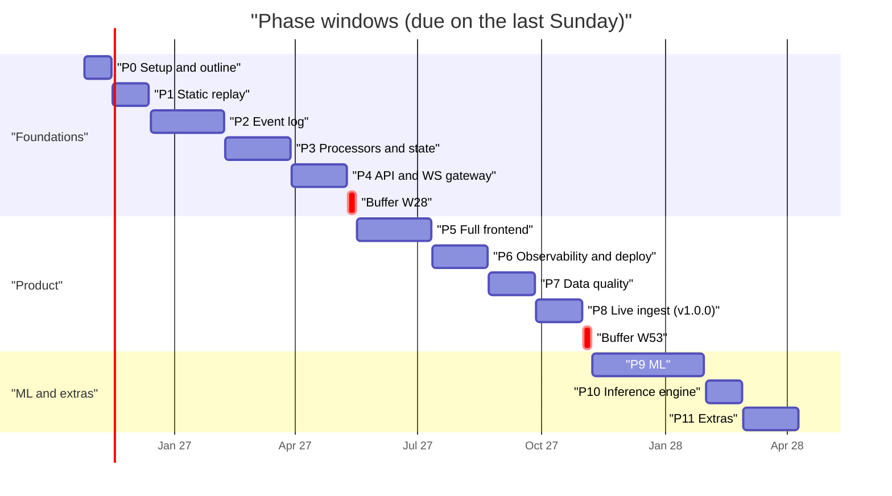
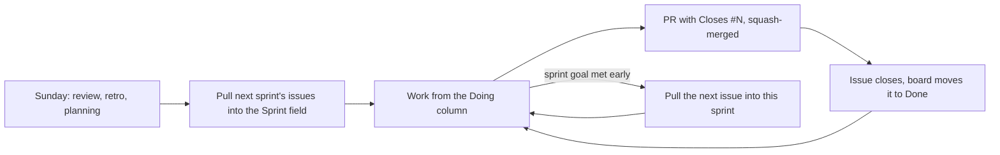

# Schedule

Dates for every phase and step, the rules for keeping them, and a log of how the plan
holds up. The board is the source of truth for status:
[pitwall project](https://github.com/users/Ekanth-Sai/projects/1). Milestones carry the phase
due dates.

## How the dates were set

- **Capacity:** about 15 h a week, in 1-week sprints, Monday to Sunday. W1 starts Mon Nov 2 2026.
- **Planned load:** about 12 h a sprint, i.e. 80% of capacity. The other 3 h absorb slips
  without moving dates.
- **Estimates:** calibrated on the pace so far: P0.1 to P0.7d took about 30 h, and a well-scoped
  step is 4 to 6 h. The total is about 740 h.
- **Holidays:** the two Dec 21 to Jan 3 sprints count as half each.
- **Buffers:** two whole empty sprints, W28 (May 10 to 16 2027) and W53 (Nov 1 to 7 2027).
- **A step's date** means "merged by the Sunday of that sprint" (P0 has daily targets).

## Phases

| Phase | Sprints | Window | Due (Sun) | Release |
|---|---|---|---|---|
| P0 Setup + outline | W1–W2 | Nov 2 – Nov 15 2026 | **Nov 15 2026** | v0.1.0 |
| P1 Static replay + demo | W3–W6 | Nov 16 – Dec 13 | **Dec 13 2026** | v0.2.0 (first public link) |
| P2 Event log | W7–W14 | Dec 14 – Feb 7 2027 | **Feb 7 2027** | v0.3.0 |
| P3 Processors + state | W15–W21 | Feb 8 – Mar 28 | **Mar 28 2027** | v0.4.0 |
| P4 API + WS gateway | W22–W27 | Mar 29 – May 9 | **May 9 2027** | v0.5.0 |
| *buffer* | W28 | May 10 – 16 | | |
| P5 Full frontend | W29–W36 | May 17 – Jul 11 | **Jul 11 2027** | v0.6.0 |
| P6 Observability + deploy | W37–W42 | Jul 12 – Aug 22 | **Aug 22 2027** | v0.7.0 |
| P7 Data quality | W43–W47 | Aug 23 – Sep 26 | **Sep 26 2027** | v0.8.0 |
| P8 Live ingest | W48–W52 | Sep 27 – Oct 31 | **Oct 31 2027** | **v1.0.0** |
| *buffer* | W53 | Nov 1 – 7 | | |
| P9 ML | W54–W65 | Nov 8 – Jan 30 2028 | **Jan 30 2028** | v1.1.0 |
| P10 Inference engine | W66–W69 | Jan 31 – Feb 27 | **Feb 27 2028** | v1.2.0 |
| P11 Extras | W70–W75 | Feb 28 – Apr 9 | **Apr 9 2028** | v1.3.0 |

**Calendar risk:** P8.6 needs a live F1 weekend in W51 (Oct 18 to 24 2027). At the P7 review
(Sep 26 2027), check the 2027 calendar and swap W51 and W52 if needed. If P8.1 picks a paid live
source, budget for it then.

## Sprints

The steps due by each sprint's Sunday. P0 has daily targets because it was in progress when the
schedule was set.

| Sprint | Dates | Steps |
|---|---|---|
| W1 | Nov 2–8 2026 | 0.7e Tue 3 · 0.7f Thu 5 · 0.7g review + PR Sun 8 |
| W2 | Nov 9–15 | 0.8 Wed 11 · 0.9 Fri 13 · 0.10 Sun 15 → v0.1.0 |
| W3 | Nov 16–22 | 1.1, 1.2 |
| W4 | Nov 23–29 | 1.3, 1.4 |
| W5 | Nov 30 – Dec 6 | 1.5, 1.6, 1.7 |
| W6 | Dec 7–13 | 1.10 → 1.9 → 1.8, 1.R |
| W7 | Dec 14–20 | 2.1, 2.2 |
| W8–9 | Dec 21 – Jan 3 (half) | 2.3, begin 2.4 |
| W10 | Jan 4–10 2027 | 2.4, 2.5 |
| W11 | Jan 11–17 | 2.6 |
| W12 | Jan 18–24 | 2.7, 2.8 |
| W13 | Jan 25–31 | 2.9, 2.10 |
| W14 | Feb 1–7 | 2.11, 2.12, 2.R |
| W15–W20 | Feb 8 – Mar 21 | 3.1 to 3.6, one a sprint |
| W21 | Mar 22–28 | 3.7, 3.8, 3.9, 3.R |
| W22 | Mar 29 – Apr 4 | 4.1, 4.2 |
| W23 | Apr 5–11 | 4.3 |
| W24 | Apr 12–18 | 4.4, 4.8 |
| W25 | Apr 19–25 | 4.5, 4.7 |
| W26 | Apr 26 – May 2 | 4.6 |
| W27 | May 3–9 | 4.9, 4.10, 4.R |
| W28 | May 10–16 | *buffer* |
| W29–W32 | May 17 – Jun 13 | 5.1 to 5.4, one a sprint |
| W33 | Jun 14–20 | 5.5, 5.6 |
| W34 | Jun 21–27 | 5.7, 5.8 |
| W35 | Jun 28 – Jul 4 | 5.9, 5.10 |
| W36 | Jul 5–11 | 5.11, 5.12, 5.R |
| W37 | Jul 12–18 | 6.1, 6.2 |
| W38 | Jul 19–25 | 6.3, 6.4 |
| W39 | Jul 26 – Aug 1 | 6.5 |
| W40 | Aug 2–8 | 6.6 |
| W41 | Aug 9–15 | 6.7, 6.8, 6.9 |
| W42 | Aug 16–22 | 6.R → 6.10 |
| W43 | Aug 23–29 | 7.1 |
| W44 | Aug 30 – Sep 5 | 7.2, 7.3 |
| W45 | Sep 6–12 | 7.4, 7.5 |
| W46 | Sep 13–19 | 7.6 |
| W47 | Sep 20–26 | 7.7, 7.8, 7.9, 7.R |
| W48 | Sep 27 – Oct 3 | 8.1, 8.2 |
| W49 | Oct 4–10 | 8.3 |
| W50 | Oct 11–17 | 8.4, 8.5 |
| W51 | Oct 18–24 | 8.6 field test (practice session, then race) |
| W52 | Oct 25–31 | 8.7, 8.8, 8.R → v1.0.0 |
| W53 | Nov 1–7 | *buffer* |
| W54–W59 | Nov 8 – Dec 19 | 9.1 to 9.6, one a sprint |
| W60–61 | Dec 20 – Jan 2 2028 (half) | 9.7 |
| W62–W64 | Jan 3–23 | 9.8, 9.9, 9.10, one a sprint |
| W65 | Jan 24–30 | 9.11, 9.12, 9.R |
| W66 | Jan 31 – Feb 6 | 10.1 |
| W67 | Feb 7–13 | 10.2 |
| W68 | Feb 14–20 | 10.3, 10.4 |
| W69 | Feb 21–27 | 10.5, 10.6, 10.7, 10.R |
| W70–W72 | Feb 28 – Mar 19 | 11.1, 11.2, 11.3, one a sprint |
| W73 | Mar 20–26 | 11.4, 11.5 |
| W74 | Mar 27 – Apr 2 | 11.6 |
| W75 | Apr 3–9 | 11.7, 11.R → v1.3.0 |

## Rules

- **Sunday, about 45 min:**
  - *Review:* demo what merged this sprint.
  - *Retro:* three lines, keep / stop / try.
  - *Planning:* pull the next sprint's issues into the new iteration.
  - Log planned and actual hours below.
- **No daily meeting.** The board is the standup: each session starts from the Doing column.
- **Ready** = the issue has a DoD checklist and an estimate. **Done** = the Definition of Done in
  [design/README.md](design/README.md), plus the PR merged and the issue closed by `Closes #N`.
- **Finishing early:** pull the next issue into the current sprint. Its due date doesn't move.
- **Slips:**
  - A step over 2× its estimate gets split.
  - A phase that misses its date uses the next buffer first.
  - Re-forecast (shift every later date) only at a phase review, never mid-sprint.
  - Velocity under 80% of plan for 2 sprints in a row → re-forecast.
  - Features are never cut, only moved.
- **Recalibrate after W3:** compare real hours to the estimates, and adjust P1 onwards if they're
  off by more than 25%.
- **At each phase review**, also check the held-back dependencies: `pnpm view typescript-eslint
  peerDependencies` (can TypeScript move?) and whether `.nvmrc` should move up, taking `@types/node`
  with it ([design/frontend.md](design/frontend.md#decisions), decisions 1 and 12).
- **Merging:** squash only (enforced in the repo settings); branches are deleted on merge.

## Velocity log

Planned is the sum of the sprint's estimates. Actual is filled in at the Sunday review.

| Sprint | Planned | Actual | Done | Notes |
|---|---|---|---|---|
| W0 (Oct 26 – Nov 1) | – | ~30 h (P0.1 to P0.7d) | P0.1–P0.6, P0.7a–d | before the schedule; used to calibrate the estimates |
| W1 (Nov 2–8) | 11 h | ~15 h (rough) | P0.7e–g, P0.8, P0.9, P0.10 (v0.1.0), P1.1, P1.2: 36 h of estimates | goal met on day 1; pulled in all of W2 and W3; Phase 0 shipped 11 days early |
| W2 (Nov 9–15) | 12 h | | | W2's own steps already done; pulled in P1.3 (6 h) and P1.4 (6 h) from W4 |

### Retros

**W1** (Nov 8)
- **Keep:** drafting in scratch, then `diff -r` against it, which caught every typo before CI did;
  `/code-review high` before each PR, which found two real gaps (Dependabot could bypass the 7-day
  release-age rule, and an ESLint pattern typo meant no file was linted).
- **Stop:** typing configuration files by hand. YAML and config cost the most time and teach the
  least; one typo silently turned ESLint off. From P1.3, Claude writes config and boilerplate, and
  the TypeScript and React that carry the concepts are typed by hand.
- **Try:** Prettier with format-on-save in VS Code; `pnpm format` before asking for a check;
  checking a tool's release age before pinning it (pnpm 12.18 was 3 days old).
- **Calibration, first data point:** about 36 h of estimates took about 15 h, so estimates may be
  roughly 2× too high. The hours are a rough recollection, so from W2 they are logged per session;
  the W3 recalibration rule decides whether later dates move.
